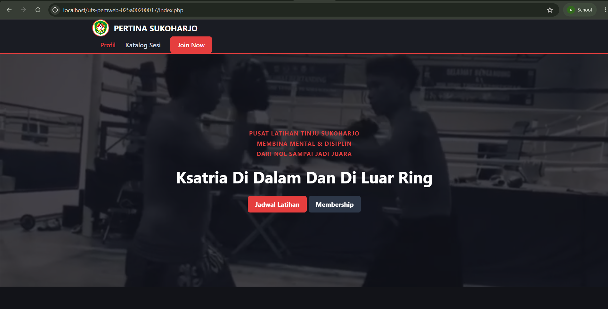
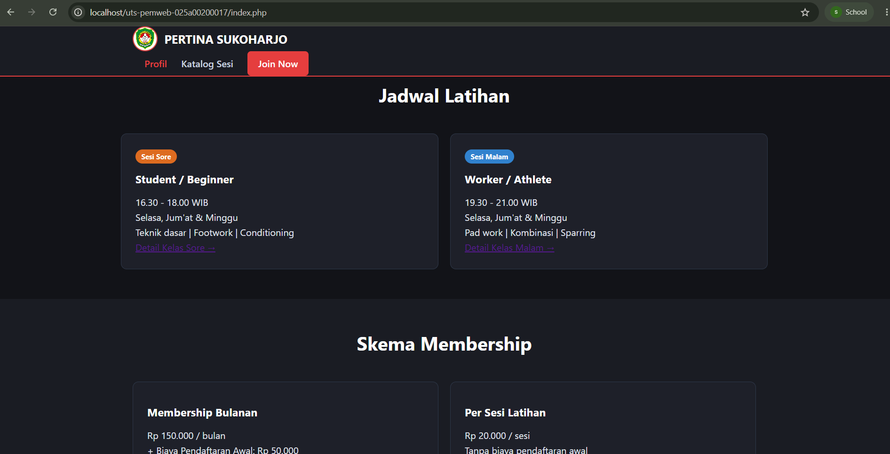
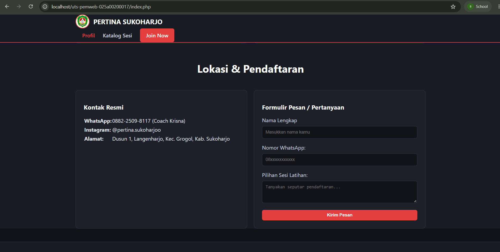
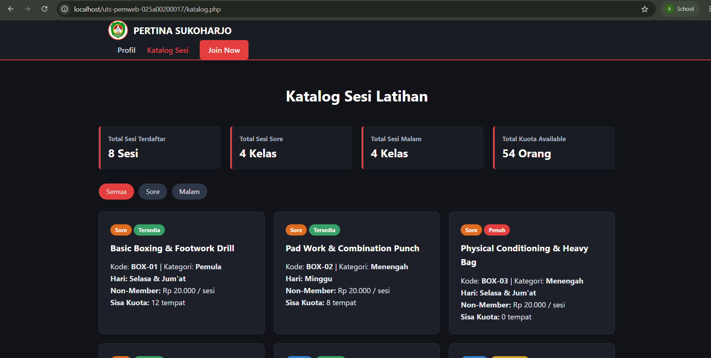

# PROYEK MINI UTS: WEBSITE NST ACADEMY

## 1. Identitas
- **Nama        :** Sultan Firsta Askaruzaman
- **NIM         :** 025a00200017
- **Kelas       :** S1 Informatika A2-3B
- **Mata Kuliah :** Pemrograman Web

## 2. Deskripsi Singkat Tema
Website ini merupakan portal profil dan katalog jadwal latihan interaktif untuk **Pertina Sukoharjo**, pusat pembinaan olahraga tinju di Kabupaten Sukoharjo.
Website ini menyediakan informasi program latihan, biaya membership/non-member, serta katalog sesi latihan sore dan malam.

## 3. Cara Jalankan di Localhost
1. Salin folder proyek `uts-pemweb-025a00200017` ke direktori web server local kamu:
    - **XAMPP:** `C:xampp/htdocs/`
    - **Laragon** `CL/laragon/www/`
2. Jalankan service **Apache** pada Control Panel XAMPP/Laragon.
3. Buka browser dan akses alamat: `http://localhost/uts-pemweb-025a00200017/index.php`

## 4. Daftar Fitur dan Penanganan File
- **Halaman Profil & Berita Prestasi (`index.php`):** Menyajikan profil camp, keunggulan, rincian biaya, dan form kontak.
- **Halaman Katalog Latihan (`katalog.php`):** Menampilkan perulangan `foreach` daftar sesi latihan secara dinamis.
- **Filter URL Interaktif (`functions.php` & `katalog.php`):** Memfilter jadwal sore/malam via paameter '$_GET["jadwal"]' dengan fungsi `filterJadwal()`.
- **Status Kuota Dinamis (`functions.php`):** Menggunakan percabangan 'match(true)' dalam fungsi `statusKuota()` dan `badgeStatusKuota()`.

## 5. Daftar Fungsi Array Bawaan yang Dipakai
1. `count()`: Menghitung total item jadwal latihan dan berita.
2. `array_column()`: Mengambil satu kuota
3. `array_sum()`: Menjumlahkan seluruh kuota latihan yang tersedia.
4. `array_filter()`: Menyaring item berdasarkan kriteria waktu latihan (Sore/Malam).
5. `in_array()`: Memvalidasi parameter filter dari URL untuk keamanan data.

## 6. Screenshots
### Halaman Profil

### Halaman Katalog Sesi

## 7. Referensi & Catatan Pemakaian AI
1. Referensi
    - Handout Pemrograman Web Pertemuan 1-7
    - Lembar Perintah UTS Proyek Mini Individu Pemrograman Web.pdf
    - Instagram Pertina Sukoharjo
2. Catatan Pemakaian AI
    - AI yang digunakan adalah notebookLM untuk meminimalisir halusinasi dan kemudahan membatasi sumber.
    - Diskusi konsep website dan ide desain UI/UX.
    - Bantuan troubleshooting bug.
    - Review kataatan kode terhadap ketentuan UTS.
